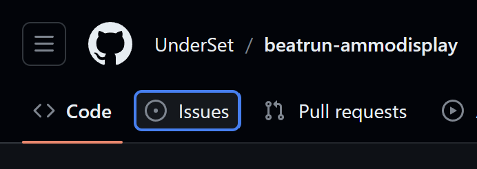

**UNSUPPORTED. Use at your own peril.**

# beatrun-ammocounter

My attempt at making an ammo display that works well with Beatrun. If it doesn't show up, run the following command in the Console: `lua_openscript_cl autorun\client\ammocounter.lua`

*Now finally automatically loads by default!*

**No, Spawnmenu options *won't* be added, even in the rewrite. Do not ask for it.**

## Features
- **Now works with most aspect ratios (except bonkers ones like 9:16)!**
- Fully clientside, works with any server that has `sv_allowcslua` allowed
- Primary ammo display, with viewpunch offset and firemode display
- Secondary/alt-fire ammo display, with mag-style altfire support *(why does no other HUD support this properly?)*
- Support for mag-less weapons

## To be done
Just check the Issues tab, will ya? *(gonna update to a GitLab pic later on, but for GitLab it's on the sidebar)**

 *No, seriously, check Issues. Please. It saves me so much time.*

## Credits
- [datæ](https://steamcommunity.com/id/75651121243836): the *original, **possibly malicious*** Beatrun gamemode
- [Arctic](https://github.com/haodongmo): some used ARC9 code for determining melee weapons
